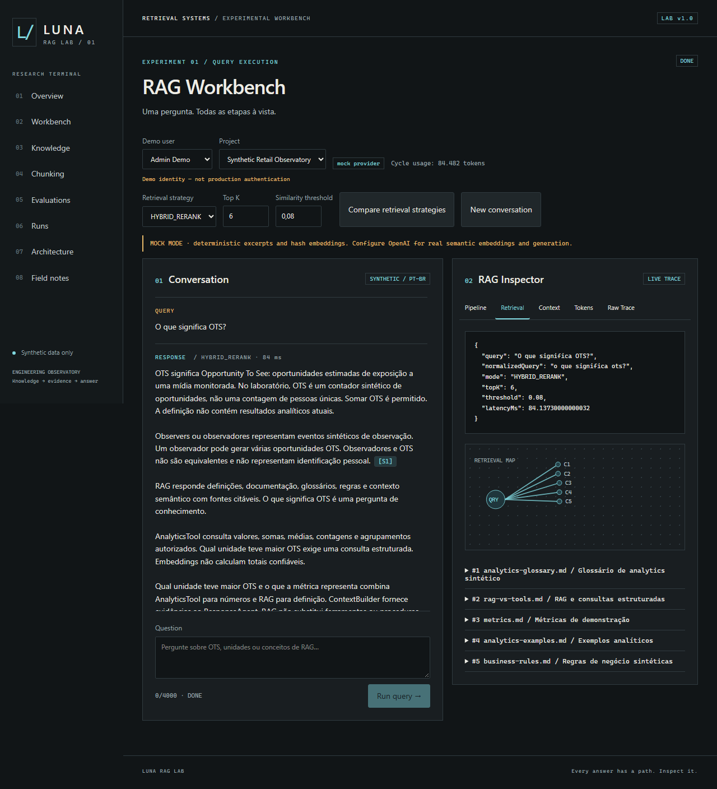
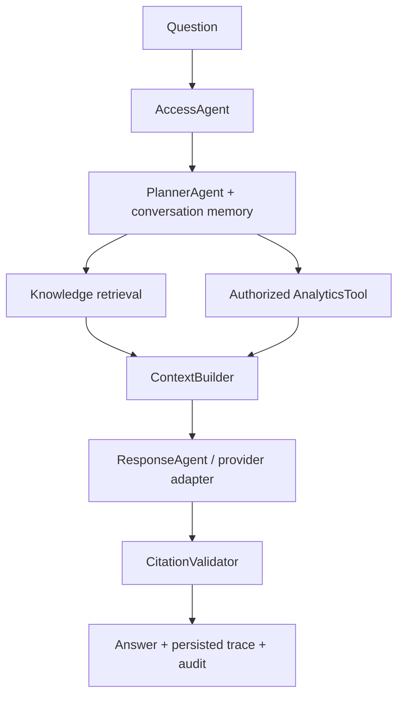

# Luna RAG Lab

RAG experimentation workbench for enterprise analytics assistants, featuring hybrid retrieval, pgvector, citations, tool routing, evaluation and observability.



## Why this exists

This is a laboratory for understanding retrieval before applying its patterns to an enterprise analytics assistant. Its knowledge, entities, metrics and records are synthetic. The implementation keeps chunking, ranking, fusion, context and tracing visible in ordinary TypeScript modules.

## What it demonstrates

- Markdown/TXT/JSON/CSV/PDF ingestion, heading-aware chunking and checksum caching.
- Semantic pgvector search, Portuguese full-text search, manual RRF and deterministic reranking.
- Typed intent planning, backend project and dataset access checks, analytical tools and conversational follow-ups.
- A streamed workbench with source citations, pipeline/retrieval/context/token/raw inspectors and an SVG Retrieval Map.
- Strategy comparison, chunking playground, reproducible evaluations and recorded traces.
- PGlite development without PostgreSQL installation or Docker, and a shared Neon production schema.

## Architecture



Access is checked before planning and again at dataset selection. The planner is deterministic; its output is validated with Zod. It selects operations and never generates SQL. Independent retrieval and tool operations execute in parallel. See [architecture](docs/architecture.md) for streaming and process ownership details.

## RAG pipeline

Document → parser → normalizer → heading-aware chunker → batch embeddings → storage. Query → query embedding → semantic/lexical search → fusion → rerank → diverse bounded context → response → citation validation.

Tokens used for chunking and context budgets are estimated as characters/4. Paid generation usage comes from the AI SDK. All embedding vectors have 256 dimensions; document and query model identities must match. Reindex after switching providers or models.

## RAG vs structured tools

RAG retrieves documentation, glossaries, policies, schemas, examples and semantic context. It does not calculate authoritative numbers. Tools query current values, sums, counts, groups, rankings and analytics. Transactional operations need their own authorized tools.

“O que significa OTS?” uses RAG. “Qual unidade teve maior OTS?” uses AnalyticsTool. A hybrid question combines a definition with an authorized numerical result. Every analytics number must originate from a ToolResult. There is no model-generated SQL or proprietary procedure in this repository.

## Retrieval strategies

SEMANTIC uses cosine similarity, `1 - cosine_distance`, through pgvector. LEXICAL uses PostgreSQL `to_tsvector`, `plainto_tsquery` and `ts_rank_cd` in Portuguese. HYBRID runs both searches concurrently and combines positions with `sum(1 / (k + rank))`, rank starting at 1 and k defaulting to 60. HYBRID_RERANK adds deterministic term-coverage ranking.

Similarity threshold applies to semantic candidates; lexical candidates can still appear in hybrid mode. Final scores from different modes are not interchangeable confidence probabilities. There is no LLM reranker implementation; the heuristic does not add a model call. `ENABLE_LLM_RERANKER` is reserved for a future optional adapter and is not used.

## Local architecture

Next.js App Router / React / strict TypeScript / Tailwind / AI SDK 7 / Zod / Drizzle / PGlite + pgvector. Local storage is `.data/pglite`, excluded from Git. Only one running process should own a PGlite directory; stop the dev server before CLI database operations. Tests use in-memory or separate `.data/e2e` databases.

## Production architecture

Vercel Node runtime → Drizzle Neon HTTP driver → PostgreSQL with pgvector. Production does not require a daemon or persistent filesystem. PGlite is rejected when running on Vercel. Migrations and seed are explicit operational steps, not build side effects.

## Running locally

Requires Node.js 22+ and pnpm 10.

```powershell
pnpm install
Copy-Item .env.example .env
pnpm db:migrate
pnpm db:seed
pnpm run doctor
pnpm dev
```

Open http://localhost:3000. The default mock provider requires no key. It uses deterministic hash embeddings and extracts text excerpts; it is not a semantic model. The UI labels this mode explicitly.

Use `pnpm run doctor`: pnpm 10 has its own built-in `pnpm doctor` command, which takes precedence over the project script.

For real AI, configure `AI_PROVIDER=openai`, `OPENAI_API_KEY`, `OPENAI_CHAT_MODEL` and `OPENAI_EMBEDDING_MODEL`, then stop the server and run `pnpm ingest`. The chat adapter uses OpenAI Responses through AI SDK v7. Choose a model available to your account. Never put API keys in `NEXT_PUBLIC` variables.

## Environment

See [.env.example](.env.example). Database: `DATABASE_MODE`, `DATABASE_URL`. Provider: `AI_PROVIDER` (`mock`, `openai`, `gateway`), `OPENAI_API_KEY`, `OPENAI_CHAT_MODEL`, `OPENAI_EMBEDDING_MODEL`. Gateway: `AI_GATEWAY_API_KEY`, `GATEWAY_CHAT_MODEL`, `GATEWAY_EMBEDDING_MODEL`; the embedding model must produce 256-dimensional vectors. Retrieval: `RAG_TOP_K`, `RAG_SIMILARITY_THRESHOLD`, `RAG_CHUNK_SIZE`, `RAG_CHUNK_OVERLAP`, `RAG_RRF_K`, `RAG_CONTEXT_BUDGET`. Governance: `MONTHLY_TOKEN_LIMIT`. Local tooling: optional `PGLITE_PATH`.

`RAG_DEBUG=true` enables the full run snapshot in Raw Trace only in development. Production Raw Trace shows a compact execution record. `ENABLE_LLM_RERANKER` is reserved for an optional adapter; the current reranker is deterministic. No secrets or complete system prompts are returned in traces.

## Database

`pnpm db:generate` generates SQL from the schema. `pnpm db:migrate` creates pgvector and applies tracked SQL statements idempotently. `pnpm db:seed` creates demo projects, four users, memberships, six sites, twelve devices, 8,064 analytics records, and ingests nine knowledge files. Records cover April and October 2026; dates outside this fixture return no rows. Seed is deterministic and repeatable.

`pnpm db:reset` resets only the local development database. It rejects PostgreSQL and production modes. The analytical datasets are authorized logical projections of the same synthetic fact table; they are not production views or copied procedures.

## Ingestion

`pnpm ingest` processes the knowledge directory. The Knowledge UI accepts uploads up to 5 MB, validates extension and MIME, parses data without execution, and supports inspect/reindex/delete. Text content and metadata are stored in PostgreSQL rather than a production filesystem. Reindex uses the configured provider; unchanged chunks reuse checksum+model cached embeddings. Deleting a document cascades its chunks and retrieval-hit references; stored run snapshots retain the historical evidence.

## Evaluation

`pnpm eval` executes the question suite and writes `reports/latest-evaluation.json` and `.md`. Results also persist in `evaluation_runs`. Metrics include Hit Rate, Precision, Recall, MRR, latency, estimated context tokens and citation usage. Values without applicable ground truth are null. Citation validity and keyword matching do not prove semantic groundedness. No LLM judge is used; a future judge must be labelled “Model-based evaluation”.

## Tests

```powershell
pnpm lint
pnpm typecheck
pnpm test
pnpm exec playwright install chromium
pnpm test:e2e
pnpm build
```

Unit tests cover chunking, overlap, RRF, context diversity/budget, citations, planning, validation, role checks, quotas, memory and malicious content. Integration tests use an actual PGlite PostgreSQL engine with pgvector. E2E tests cover desktop and mobile, streamed chat, citations, inspector, comparison, knowledge, chunking and evaluations. They use the mock provider and never need OpenAI or internet after dependencies and browsers are installed.

## Vercel deployment

1. Create a Vercel project and connect this GitHub repository.
2. Create or connect a Neon PostgreSQL database.
3. Configure `DATABASE_MODE=postgres` and `DATABASE_URL` in the environment used for migrations and deployment.
4. Run `pnpm db:migrate`; it enables pgvector. The database role needs permission to create the extension.
5. Optionally run `pnpm db:seed` using the intended provider. The seed contains only demonstration data.
6. Configure provider/model variables and secrets. Use mock for a public plumbing demo, or a real provider after applying authentication and operational controls.
7. Build command is `pnpm build`, install is `pnpm install --frozen-lockfile`. Deploy using Vercel's Git integration or `vercel --prod` after linking the intended project.

The local implementation is deployable to Vercel; this repository does not provision Neon, configure credentials or claim a live deployment. Uploads require the host's request limits to permit the body size; Vercel may impose a lower limit than the local 5 MB validator.

## Security considerations

All content is synthetic. Demo identities are intentionally selectable and are not authentication. Membership, conversation ownership and dataset permissions are checked server-side, but anyone using the public lab can select Admin Demo. Replace identity selection with verified sessions before using confidential documents or paid public endpoints.

Tools validate allowlists and parameterize queries. Retrieved content is untrusted, cannot invoke tools, change permissions or expose prompts. A synthetic malicious document tests this boundary; deterministic filtering of known injection phrases is defense in depth, not a complete detection strategy. LLM behavior against unseen injections is not guaranteed by mock tests.

Chat has per-process rate limiting. Paid generation uses atomic monthly quota reservations and settlement; cached tokens are tracked separately. Uncached embedding usage is recorded as otherTokens and counts toward subsequent generation checks; embedding calls themselves do not reserve quota. Multi-instance public production use needs shared rate limiting and authenticated identities. No raw HTML from documents is rendered. Error responses omit stack traces; traces never include API keys or full system prompts.

## Experiments

`pnpm experiment` reindexes and evaluates three chunk/overlap/topK/strategy configurations and restores the default corpus in a finally block. It writes `reports/latest-experiment.json`. Stop the app before this command and do not use it on a live shared production database. The workbench comparison provides four strategies for one query without altering the index.

## Future migration

Transfer contracts and measured practices, not proprietary code: typed planner actions, access boundaries, authorized analytics intent, context budgets, source IDs, trace and evaluation metrics. A Java/enterprise application can implement these contracts independently. RAG supplies domain knowledge around authorized procedures; it never replaces numerical query execution. See [future integration](docs/future-integration.md).

## References

- [AI SDK generateText](https://ai-sdk.dev/docs/reference/ai-sdk-core/generate-text)
- [OpenAI Responses](https://developers.openai.com/api/reference/responses/overview)
- [OpenAI embeddings](https://developers.openai.com/api/reference/resources/embeddings/methods/create)
- [Drizzle PGlite](https://orm.drizzle.team/docs/get-started/pglite-new)

License: MIT. Recommended GitHub topics: rag, retrieval-augmented-generation, nextjs, typescript, vercel, pgvector, postgresql, openai, embeddings, vector-search, ai-sdk.
